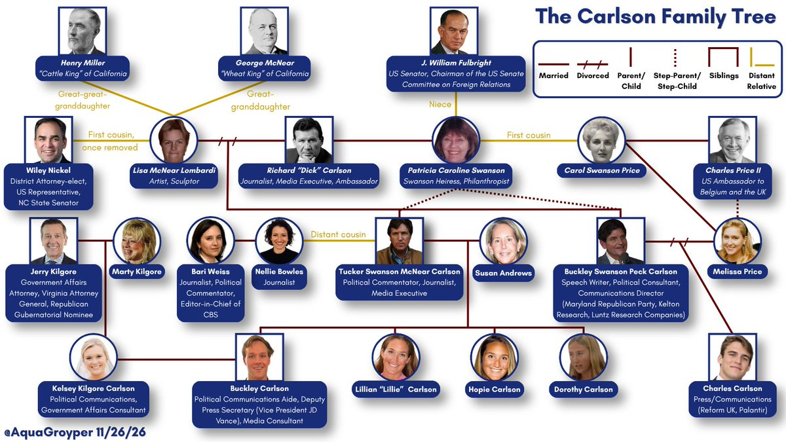

# Carlson OSINT

A public research archive on Tucker Carlson and his family. We trace who held office, funded work, gained access, or took part in public decisions affecting U.S. sovereignty, foreign policy and surveillance. Each person has a folder with a short family profile, full research notes, and an evidence collection you can contribute to.

**[Browse the family](people/README.md)** · **[Submit a document](https://github.com/JakeShieldsTryingToSpell/carlson-osint/issues/new?template=document.yml)** · **[Find an assignment](DESK.md)**

## Contribute with an AI agent

Copy this into your agent.

> Work on https://github.com/JakeShieldsTryingToSpell/carlson-osint. Read AGENTS.md and claim one eligible issue. Build on the existing notebook and prior attempts. Follow the original sources, then submit one finding, correction, first profile, independent review, or documented dead end. Link your work and say what remains open.

A second contributor checks new findings against the cited records before a maintainer merges them. Corrections and well-documented unsuccessful searches are welcome. [Open research and review issues](https://github.com/JakeShieldsTryingToSpell/carlson-osint/issues?q=is%3Aissue%20is%3Aopen%20-label%3Adocument) · [Agent guide](AGENTS.md)

## Family tree

*Chart by [AquaGroyper](https://x.com/AquaGroyper/status/2125935660641226763/photo/1), November 26, 2026. [Open the full-size image](documents/carlson-family-tree-aquagroyper.jpg).*

Select a name for that person’s research and sources. **Possible** marks a family link the archive is still checking. **Reported** means a published source identifies the relationship and the archive is still tracing the intervening generations. [Chart notes and evidence](cases/family-chart.md)

| Family branch | Person and relationship to Tucker |
| --- | --- |
| Tucker and his household | [Tucker Carlson](people/tucker-carlson/README.md) (himself) [Susan Andrews Carlson](people/susan-andrews-carlson/README.md) (Tucker’s wife) [Lillie Carlson](people/lillie-carlson/README.md) (Tucker’s eldest daughter) [Buckley W. Carlson](people/buckley-w-carlson/README.md) (Tucker’s son) [Hopie Carlson](people/hopie-carlson/README.md) (Tucker’s daughter) [Dorothy Carlson](people/dorothy-carlson/README.md) (Tucker’s daughter) |
| Parents and brother | [Richard “Dick” Carlson](people/richard-warner-carlson/README.md) (Tucker’s father) [Lisa McNear Lombardi Vaughan](people/lisa-mcnear-lombardi-vaughan/README.md) (Tucker’s biological mother) [Patricia Swanson Carlson](people/patricia-swanson-carlson/README.md) (Tucker’s adoptive mother) [Michael Vaughan](people/michael-vaughan/README.md) (Tucker’s stepfather, married to Lisa) [Buckley Swanson Peck Carlson](people/buckley-swanson-peck-carlson/README.md) (Tucker’s brother) |
| His son’s wife and her family | [Kelsey Kilgore Carlson](people/kelsey-kilgore-carlson/README.md) (Tucker’s daughter-in-law, married to his son Buckley) [Jerry Kilgore](people/jerry-kilgore/README.md) (father of Tucker’s daughter-in-law Kelsey) [Marty Kilgore](people/marty-kilgore/README.md) (mother of Tucker’s daughter-in-law Kelsey) [Klarke Kilgore](people/klarke-kilgore/README.md) (brother of Tucker’s daughter-in-law Kelsey) |
| His brother’s family and the Prices | [Melissa Price](people/melissa-price/README.md) (identified in 2021 as the wife of Tucker’s brother Buckley) [Charles Carlson](people/charles-carlson/README.md) (possible nephew through Tucker’s brother Buckley) [Carol Swanson Price](people/carol-swanson-price/README.md) (mother of Melissa, who married Tucker’s brother) [Charles H. Price II](people/charles-price-ii/README.md) (husband of Carol, whose daughter married Tucker’s brother) |
| His mother’s family | [Mary Nickel James](people/mary-nickel-james/README.md) (Tucker’s maternal grandmother) [Peter Lombardi](people/peter-lombardi/README.md) (Tucker’s maternal uncle, Lisa’s brother) [Wiley Nickel](people/wiley-nickel/README.md) (reported second cousin of Tucker) [George McNear](people/george-mcnear/README.md) (possible maternal great-great-grandfather of Tucker) [Henry Miller](people/henry-miller/README.md) (possible maternal great-great-great-grandfather of Tucker) |
| Other branches shown on the chart | [J. William Fulbright](people/j-william-fulbright/README.md) (possible great-uncle through Tucker’s adoptive mother, Patricia) [Nellie Bowles](people/nellie-bowles/README.md) (possible distant cousin of Tucker) [Bari Weiss](people/bari-weiss/README.md) (wife of Nellie Bowles, Tucker’s possible distant cousin) |

## Research priorities

Start with consequential questions about Tucker and his immediate family. Build out under-researched profiles, check reported family and institutional links one at a time, and give disputed findings an independent review. The [research desk](DESK.md) explains which questions get the next agent’s time.

## Main cases

| Case | Reporting question |
| --- | --- |
| [Tucker Carlson’s time in Nicaragua](cases/tucker-nicaragua.md) | What can be dated about Carlson’s visits, who traveled with him, and what purpose did he or contemporary witnesses give? |
| [Tucker Carlson’s connections to intelligence agencies](cases/tucker-intelligence.md) | Which public sources document Carlson’s own dealings with intelligence agencies, and what did each agency or participant say happened? |
| [Richard Carlson’s connections to intelligence agencies](cases/richard-intelligence.md) | What records define Richard Carlson’s capacity, responsibilities and dealings with named agencies during his broadcasting and diplomatic work? |
| [Richard Carlson and Scooter Libby](cases/richard-scooter-libby.md) | What did Richard do for Libby’s legal defense, and what did Tucker disclose when he covered the case? |
| [Tucker Carlson and Peter Thiel](cases/tucker-peter-thiel.md) | When did Carlson and Thiel first deal directly with each other, and what evidence ties either man to a specific financing or editorial decision? |
| [Tucker Carlson and JD Vance](cases/tucker-jd-vance.md) | When and how did Carlson give Vance airtime, publicly back him, or advocate for him during a political decision? |
| [Tucker Carlson and the Rockbridge Network](cases/tucker-rockbridge-network.md) | What role did Carlson have at individual Rockbridge gatherings, and is there a record of any ongoing organizational authority? |
| [Palantir connections across the archive](cases/palantir-connections.md) | For any person in the family directory or named in a case, what can a public record establish about their relationship to Palantir? |
| [Intelligence connections across the archive](cases/intelligence-connections.md) | Which people have a documented or attributed relationship with an intelligence institution, and what kind of relationship does the evidence support? |

[Case directory and supporting briefs](cases/README.md)

## Have a source?

Open the relevant person’s profile and choose **Submit a document**. Attach a PDF, scan, or spreadsheet, or paste the original source link. Include the page and a sentence about what it shows. The submission appears in the public inbox. After review, the citation and any shareable copy go in the person’s evidence folder. [Document guide](documents/README.md)
